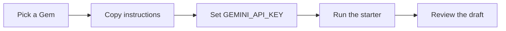

<div align="center">

# Gemini Gems Gallery

33 copy-ready Gemini Gems for work, engineering, learning, and home.

[](#the-gems)
[](downloads/Gemini-Gems-Guide.pdf)
[](downloads/gemini-gems-pack.zip)
[](downloads/Gemini-Gems-Overview.pptx)
[](site/index.html)
[](LICENSE)

</div>

<a id="the-gems"></a>

## The desks

Each file in [gems/](gems/01-sales-call-prep-desk.md) is one Gem: a role, the inputs it needs, the steps it follows, the output shape, and the rules it will not break. The [offline gallery](site/index.html) adds search, category filters, copy buttons, a light theme, a dark theme, and a [printable view](site/print.html).

Three rules hold for the whole set:

- **Draft only.** A Gem writes text. You send, book, pay, post, merge, and file.
- **No invented facts.** If a number, date, or quote is not in your material, the Gem marks it UNKNOWN.
- **Narrow child data.** Desks about a child ask for a first name and an age band, and they do not give final homework answers.

<a id="workday"></a>

### Workday

| | Desk | Page | What it does |
|---|---|---|---|
| 🎯 | [Sales Call Prep Desk](gems/01-sales-call-prep-desk.md) | [Open](site/gems/01-sales-call-prep-desk.html) | A cited account brief, discovery questions, objection handling, and one next-step ask. It never writes to a CRM, and nothing is emailed without your OK. |
| 📝 | [Meeting Recap Desk](gems/02-meeting-recap-desk.md) | [Open](site/gems/02-meeting-recap-desk.html) | Decisions, action items, and owners from notes or a transcript. Nothing is sent or shared until you approve it. |
| 🗓️ | [Weekly Planning Desk](gems/05-weekly-planning-desk.md) | [Open](site/gems/05-weekly-planning-desk.html) | Must, Should, and Could lanes plus focus blocks sized to the hours you actually have. It never sends invites or books time without your OK. |
| 📬 | [Inbox Triage Desk](gems/06-inbox-triage-desk.md) | [Open](site/gems/06-inbox-triage-desk.html) | Reply, Delegate, Schedule, and FYI lanes with quoted asks, deadlines, and short drafts. Nothing is sent, and archive and label stay with you. |
| 💰 | [Budget Tracker Desk](gems/08-budget-tracker-desk.md) | [Open](site/gems/08-budget-tracker-desk.html) | A categorized budget-versus-actual report with the math shown and recurring charges flagged. Card numbers are masked, and it never moves money. |
| 💬 | [Support Reply Desk](gems/11-support-reply-desk.md) | [Open](site/gems/11-support-reply-desk.html) | An empathetic, on-policy reply draft plus an internal note. It never issues refunds or credits, and nothing is sent without your OK. |
| 📋 | [SOP Writer Desk](gems/12-sop-writer-desk.md) | [Open](site/gems/12-sop-writer-desk.html) | A numbered, role-tagged SOP with inputs and checks. Every gap is flagged for an expert. Nothing is shared or published without your OK. |
| 🚀 | [Onboarding Guide Desk](gems/13-onboarding-guide-desk.md) | [Open](site/gems/13-onboarding-guide-desk.html) | A sourced first day, first week, and 30/60/90 guide with an access checklist. It never creates accounts or sends invites. |
| 📊 | [Money Desk](gems/26-money-desk.md) | [Open](site/gems/26-money-desk.html) | Budgets, receipts, read-only figures, and a paper-trading lab. No real trades, no money movement, and no financial, tax, or legal advice. |
| 🧾 | [Receipt and Expense Desk](gems/31-receipt-and-expense-desk.md) | [Open](site/gems/31-receipt-and-expense-desk.html) | A categorized, reconciled expense report with policy flags and totals. Card numbers are masked, and nothing is submitted without your OK. |
| 🎉 | [Event Planner Desk](gems/33-event-planner-desk.md) | [Open](site/gems/33-event-planner-desk.html) | Vendor options, a run-of-show, a budget table, and guest-message drafts. No inquiry, invite, booking, or deposit happens without your OK. |
<a id="engineering"></a>

### Engineering

| | Desk | Page | What it does |
|---|---|---|---|
| 🔍 | [PR Review Desk](gems/17-pr-review-desk.md) | [Open](site/gems/17-pr-review-desk.html) | Anchored findings ranked Blocker, Major, Minor, and Nit. It never approves, merges, or posts comments on its own. |
| 🐞 | [Bug Triage Desk](gems/18-bug-triage-desk.md) | [Open](site/gems/18-bug-triage-desk.html) | Severity, repro status, duplicate candidates, and missing-info asks. It never labels, assigns, closes, or files issues on its own. |
| 🧯 | [Incident Postmortem Desk](gems/19-incident-postmortem-desk.md) | [Open](site/gems/19-incident-postmortem-desk.html) | A cited timeline, a blameless analysis, a labeled root cause, and proposed actions. It never pages, rolls back, merges, deploys, or assigns. |
| 📘 | [Runbook Desk](gems/20-runbook-desk.md) | [Open](site/gems/20-runbook-desk.html) | A step-by-step runbook with verify checks and checkpoints before risky steps. Unverified commands are marked. It never runs a command. |
| 📚 | [API Docs Desk](gems/21-api-docs-desk.md) | [Open](site/gems/21-api-docs-desk.html) | A sourced endpoint reference with safe, illustrative examples. It never calls live APIs or commits docs on its own. |
| 🗺️ | [Architecture Diagram Desk](gems/22-architecture-diagram-desk.md) | [Open](site/gems/22-architecture-diagram-desk.html) | A sourced component inventory and a Mermaid diagram, with inferred links marked. It never changes your infrastructure. |
<a id="career-learning"></a>

### Career & Learning

| | Desk | Page | What it does |
|---|---|---|---|
| ✂️ | [Resume Tailor Desk](gems/03-resume-tailor-desk.md) | [Open](site/gems/03-resume-tailor-desk.html) | Match, Stretch, and Gap against one posting, then a tailored draft. It never invents a title, date, or metric, and you submit applications yourself. |
| 🎤 | [Interview Prep Desk](gems/09-interview-prep-desk.md) | [Open](site/gems/09-interview-prep-desk.html) | A question bank for one role, mapped to your own true stories, plus mock drills with feedback. No invented stories and no help during a live interview. |
| 🧭 | [Study Plan Desk](gems/10-study-plan-desk.md) | [Open](site/gems/10-study-plan-desk.html) | A weekly plan sized to the hours you really have, with each week flagged Fits, Tight, or Over. Nothing is bought or shared without your OK. |
| 🛰️ | [Signal Brief Desk](gems/14-signal-brief-desk.md) | [Open](site/gems/14-signal-brief-desk.html) | A ranked weekly brief with citations. Nothing is emailed, shared, or published without your OK. |
| 📣 | [Social Post Desk](gems/15-social-post-desk.md) | [Open](site/gems/15-social-post-desk.html) | Three platform-fit variants with hooks, hashtags, and alt text. It never posts, schedules, or boosts anything without your OK. |
| 📰 | [Newsletter Desk](gems/16-newsletter-desk.md) | [Open](site/gems/16-newsletter-desk.html) | A cited issue with three subject lines, a preheader, sections, and one call to action. It never sends broadcasts. You send from your own email tool. |
| ✅ | [Claim Check Desk](gems/23-claim-check-desk.md) | [Open](site/gems/23-claim-check-desk.html) | Pass, Partial, or Fail grades in one sourced packet. Nothing is shared or published without your OK. |
| 🥊 | [Competitive Landscape Desk](gems/24-competitive-landscape-desk.md) | [Open](site/gems/24-competitive-landscape-desk.html) | A sourced comparison table, clear options, and a recommendation. Nothing is shared or published without your OK. |
| 🏅 | [Certification Coach Desk](gems/25-certification-coach-desk.md) | [Open](site/gems/25-certification-coach-desk.html) | A read of published objectives and original practice questions. No brain dumps, no invented exam facts, and no pass guarantees. |
| 🌍 | [Language Drill Desk](gems/27-language-drill-desk.md) | [Open](site/gems/27-language-drill-desk.html) | Short vocabulary, grammar, and dialogue drills with Correct, Close, or Miss feedback. Uncertain forms are flagged. Nothing is paid for or shared without your OK. |
| 🍎 | [Lesson Plan Desk](gems/28-lesson-plan-desk.md) | [Open](site/gems/28-lesson-plan-desk.html) | Objectives, timed activities, differentiation, an exit quiz, and an answer key. Standards are cited or marked UNKNOWN. |
<a id="home-family"></a>

### Home & Family

| | Desk | Page | What it does |
|---|---|---|---|
| 🌙 | [Bedtime Story Desk](gems/04-bedtime-story-desk.md) | [Open](site/gems/04-bedtime-story-desk.html) | A calm story from a first name and interests, with length and reading-level controls. No scary content, no real people, and no data beyond a first name. |
| ✏️ | [Homework Coach Desk](gems/07-homework-coach-desk.md) | [Open](site/gems/07-homework-coach-desk.html) | Socratic hints, a check-your-work step, and a short parent summary. It never gives final answers for graded work and never helps with tests or quizzes. |
| 🔬 | [Curious Kids Science Desk](gems/29-curious-kids-science-desk.md) | [Open](site/gems/29-curious-kids-science-desk.html) | An answer at the child's level, a fact check, one safe experiment, and a follow-up question. Every experiment needs an adult, and unknowns are said honestly. |
| 🧹 | [Family Chore Chart Desk](gems/30-family-chore-chart-desk.md) | [Open](site/gems/30-family-chore-chart-desk.html) | A fair rotation, a points chart, and a weekly reset. It uses first names and age bands only, and it never buys rewards without your OK. |
| ✈️ | [Travel Itinerary Desk](gems/32-travel-itinerary-desk.md) | [Open](site/gems/32-travel-itinerary-desk.html) | A day-by-day plan with sourced times and prices, transfer buffers, and a pre-trip checklist. It never books or pays. |

<a id="install"></a>

## Install a Gem

1. Open a file in [gems/](gems/02-meeting-recap-desk.md) and copy the text fence.
2. Go to [gemini.google.com](https://gemini.google.com), then **Gems > New Gem**.
3. Name it, paste the instructions, and save.
4. Start with the example on that desk's [gallery page](site/index.html).

<a id="build-an-app"></a>

## Build an app with a Gem



The starters live in [examples/README.md](examples/README.md). They read `GEMINI_API_KEY` from the environment. Get a key in [Google AI Studio](https://aistudio.google.com/apikey).

```bash
pip install -r scripts/requirements.txt
export GEMINI_API_KEY="your-key"
python examples/gem_app.py gems/02-meeting-recap-desk.md "Recap these notes: ..."
```

Rebuild this gallery from the catalog with [scripts/build_gallery.py](scripts/build_gallery.py). Check links with [scripts/check_links.py](scripts/check_links.py). Fonts in the site and the PDF are [Inter](scripts/fonts/OFL.txt), under the SIL Open Font License.

## Downloads

| File | What it is |
|---|---|
| [Gemini-Gems-Guide.pdf](downloads/Gemini-Gems-Guide.pdf) | Designed guide to all 33 desks |
| [gemini-gems-pack.zip](downloads/gemini-gems-pack.zip) | Gallery, instructions, starters, guide, and deck |
| [Gemini-Gems-Overview.pptx](downloads/Gemini-Gems-Overview.pptx) | Overview deck with a link to every desk |

## Repository

```
gems/         one Markdown file per Gem
site/         offline gallery, one page per Gem
downloads/    PDF guide, ZIP pack, PowerPoint deck
examples/     Python and JavaScript starters
scripts/      generator, link checker, and fonts
```

To publish the gallery, serve the repository root and open [site/index.html](site/index.html).

## License

- Content (instructions, prompts, gallery text, the guide): [CC BY 4.0](https://creativecommons.org/licenses/by/4.0/)
- Code in [examples/](examples/README.md) and [site/](site/index.html): [MIT](LICENSE)

Gemini and Google AI Studio are trademarks of Google LLC. This project is not affiliated with Google.
