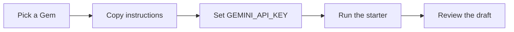

# Build an app with a Gem

A Gem is a system prompt with a job and a set of rules. These starters load that prompt from a file in [gems/](../gems/02-meeting-recap-desk.md) and send one user message to the Gemini API.



The same flow is on the [gallery page](../site/index.html#build-an-app).

## What the starter reads

Each Gem file has one fenced `text` block. That block is the whole instruction. The starter uses the first block and ignores the rest of the page. Do not add a second `text` fence.

## Set the key

Create a key in [Google AI Studio](https://aistudio.google.com/apikey). Put it in the environment. Do not write it into a source file.

```bash
export GEMINI_API_KEY="your-key"
```

Optional: `GEMINI_MODEL` overrides the default model, `gemini-2.5-flash`.

## Python

```bash
pip install google-genai
python examples/gem_app.py gems/02-meeting-recap-desk.md "Recap these notes: We will ship the export fix on Thursday. Priya owns the patch."
```

The script is [gem_app.py](gem_app.py). Run it from the repository root so the Gem path resolves.

## JavaScript

Node 18 or newer.

```bash
npm install @google/genai
node examples/gem_app.mjs gems/02-meeting-recap-desk.md "Recap these notes: We will ship the export fix on Thursday. Priya owns the patch."
```

The script is [gem_app.mjs](gem_app.mjs).

## What you get back

You get a draft in the terminal. The model is not connected to your mail, calendar, bank, or repository. If you want a different desk, change the file path. The meeting recap above is a safe sample because the notes are included in the prompt.

## More

- [Gallery](../site/index.html)
- [Printable view](../site/print.html)
- [PDF guide](../downloads/Gemini-Gems-Guide.pdf)
- [README](../README.md)
